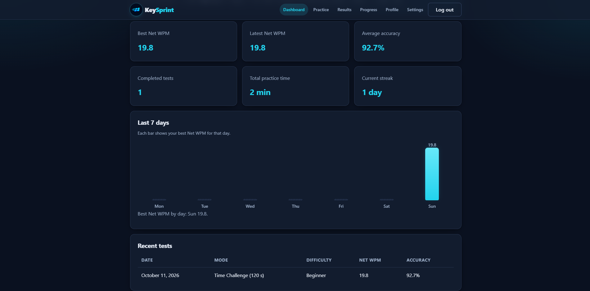
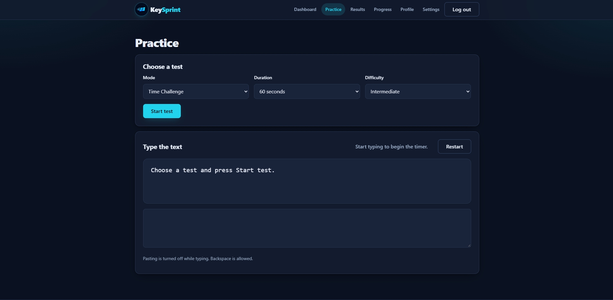
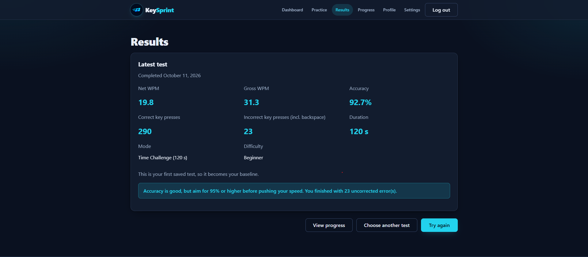
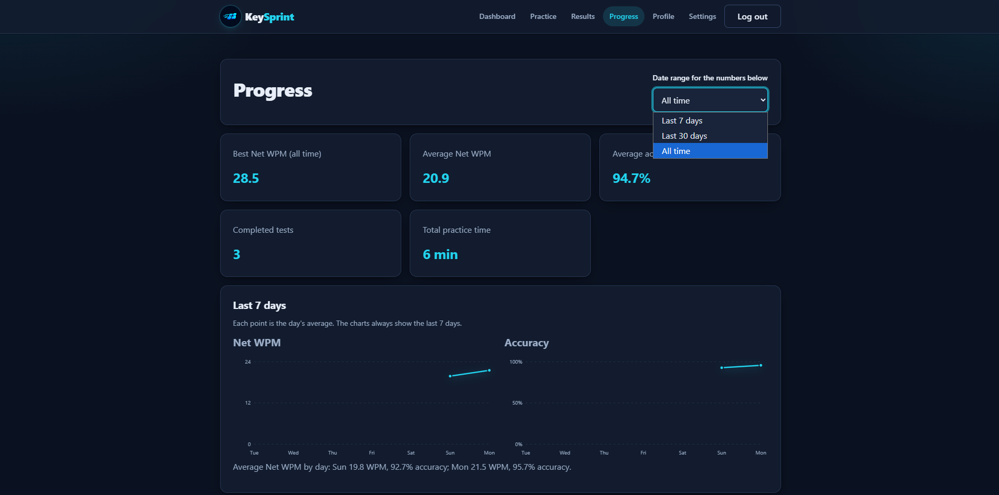
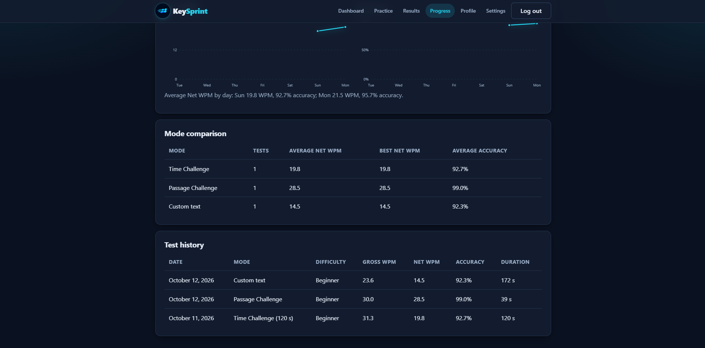
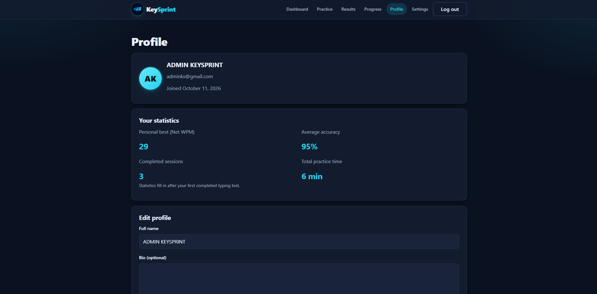
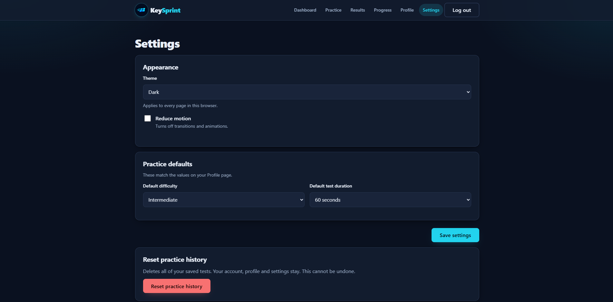

# KeySprint

**Type Faster. Think Sharper. Improve Every Day.**

KeySprint is a typing practice web app. It measures speed and accuracy across timed tests, passage tests and custom text, then shows your progress over time.

Built with HTML5, CSS3 and vanilla JavaScript. It needs no framework, no build step, no server and no paid services.

**Live demo:** [https://dhiraj1574.github.io/KeySprint-Web-Application/](https://dhiraj1574.github.io/KeySprint-Web-Application/)

---

## Table of contents

1. [Problem statement](#problem-statement)
2. [Key features](#key-features)
3. [Screenshots](#screenshots)
4. [Technologies used](#technologies-used)
5. [Getting started](#getting-started)
6. [Project structure](#project-structure)
7. [Architecture and data model](#architecture-and-data-model)
8. [Scoring formulas](#scoring-formulas)
9. [Authentication and security](#authentication-and-security)
10. [Testing](#testing)
11. [Known limitations](#known-limitations)
12. [Future improvements](#future-improvements)
13. [Author](#author)

---

## Problem statement

Many typing tests show only a raw speed number. They ignore mistakes, do not save history and do not show whether a user is improving. KeySprint measures speed and accuracy together, saves every result, and turns the saved data into a dashboard, progress charts and rules-based feedback.

---

## Key features

- **Three practice modes:** Time Challenge (2, 5, 10, 15 or 20 minutes), Passage Challenge (finish the passage) and Custom text (your own text, up to 4,000 words, with a 10, 15 or 20 minute timer).
- **Word goal:** Time Challenge tests of 10 minutes or more show a live word counter toward 2,000 words. Custom text shows the word count of your text.
- **Three difficulty levels:** Beginner, Intermediate and Advanced, with bundled passages, so no internet connection is needed.
- **Live typing feedback:** correct characters in cyan, incorrect characters in red with an underline, and the current character highlighted. Long text scrolls with you.
- **Accurate scoring:** Gross WPM, Net WPM and accuracy, calculated from every key press, including backspace.
- **Results page:** Net WPM, Gross WPM, accuracy, key press counts, duration, a personal-best comparison and feedback based on your numbers.
- **Dashboard:** greeting, level, best and latest speed, average accuracy, completed tests, practice time, current streak, a 7-day chart and recent tests.
- **Progress page:** summary numbers with a date filter (last 7 days, last 30 days, all time), 7-day Net WPM and accuracy charts, a comparison of Time, Passage and Custom modes, and full test history.
- **Profile:** avatar with initials, editable name and bio, and preferred difficulty and duration.
- **Settings:** light and dark themes, reduced motion, practice defaults and practice history reset.
- **Demo accounts:** registration, login, logout and protected pages. Each account's data is kept separate.
- **Responsive design:** works on phones, tablets and desktops, with visible keyboard focus indicators.

---

## Screenshots

### Dashboard


### Practice


### Results


### Progress



### Profile


### Settings


---

## Technologies used

| Area | Technology |
|---|---|
| Structure | HTML5 (semantic elements, labelled forms, ARIA where needed) |
| Styling | CSS3 (custom properties for theming, Flexbox, Grid, media queries) |
| Logic | Vanilla JavaScript (async/await, DOM APIs) |
| Storage | `localStorage`, with a versioned data envelope |
| Password hashing | Web Crypto API (PBKDF2 with SHA-256) |
| Charts | Inline SVG, drawn by JavaScript |

---

## Getting started

1. Download or clone this repository.
2. Open the project folder.
3. Double-click `index.html`.

No server, installation or build step is needed. The app runs directly from the file system.

You can also try the app online at the live demo link above, without downloading anything.

**Browser support:** current versions of Chrome, Edge, Firefox and Safari. The Web Crypto API is required for registration and login.

---

## Project structure

````text
KeySprint-Web-Application/
├── index.html              Entry page. Redirects to login or dashboard.
├── README.md
├── .gitignore
├── assets/
│   ├── images/             Screenshots used in this README
│   └── KeySprint_logo.png
├── css/
│   ├── style.css           Design tokens, base styles and layout
│   ├── components.css      Buttons, inputs, cards, alerts, charts, modals
│   └── responsive.css      Breakpoints for tablet, laptop and phone
├── js/
│   ├── storage.js          The only file that reads or writes localStorage
│   └── app.js              All page logic, in numbered sections
└── pages/
    ├── login.html
    ├── register.html
    ├── dashboard.html
    ├── practice.html
    ├── results.html
    ├── progress.html
    ├── profile.html
    └── settings.html
````

`js/app.js` is organised into numbered sections:

1. Helpers (validation, hashing, IDs, paths)
2. Accounts (register, log in, log out, sessions)
3. Route guard (protected and guest-only pages)
4. Theme and navigation
5. Forms (login and register)
6. Profile
7. Practice (typing engine, scoring, saving)
8. Results
9. Dashboard
10. Progress
11. Settings
12. Start (runs everything when the page loads)

---

## Architecture and data model

### How the pages connect

Each page loads `storage.js` first, then `app.js`. Each page declares its role on `<body>`:

- `data-page`: which page it is, used to highlight the navigation.
- `data-nav`: `show` or `none`, for pages that display the navigation bar.
- `data-protected`: `true` for pages that need a logged-in user.

On every page load, the route guard checks the session and redirects when needed.

### Storage keys

All keys start with `keysprint:v1:`, so the app never touches data from other websites.

| Key | Contents |
|---|---|
| `users` | Map of user ID to profile: name, email, salt, password hash, bio, join date and preferences |
| `session` | The logged-in user's ID and the time the session started |
| `settings` | Theme and reduced-motion preference |
| `sessions` | Map of user ID to a list of saved practice results |

Each saved value is wrapped in an envelope:

````json
{ "schemaVersion": 1, "savedAt": "2026-10-11T10:00:00.000Z", "data": { } }
````

If a value is missing, unreadable or has the wrong shape, the app uses a safe default. Unreadable data is copied to a `backup:` key before it is removed, so nothing is lost silently.

### One record per practice result

Each saved test contains: mode, difficulty, duration, Gross WPM, Net WPM, accuracy, correct and total key presses, uncorrected errors, typed characters and the completion time. Each user's tests are stored only under that user's ID.

---

## Scoring formulas

These formulas are used on the Results, Dashboard and Progress pages.

**Definitions**
- **Inserted characters:** characters typed, not counting backspace.
- **Backspace presses:** every removed character.
- **Total key presses:** inserted characters plus backspace presses.
- **Correct key presses:** inserted characters that matched the target at that position.
- **Uncorrected errors:** positions in the final text that still differ from the target.
- **Minutes:** Time Challenge uses the selected duration. Passage and Custom tests use the measured time from the first key press to the finish. The minimum is 1 second, which prevents division by zero.

**Formulas**

````text
Gross WPM = (inserted characters / 5) / minutes
Net WPM   = max(0, Gross WPM - uncorrected errors / minutes)
Accuracy  = correct key presses / total key presses x 100
````

**Rules**
- One word equals five characters, including spaces and punctuation.
- Corrected mistakes count against accuracy, because every key press is counted.
- Net WPM is never negative.
- Results are rounded to one decimal place.
- A test with no typed characters is not saved.
- Curly and straight quotes count as the same character.

**Rules-based feedback**
- Accuracy below 90%: slow down and focus on the correct keys.
- Accuracy from 90% to 94.9%: aim for 95% or higher.
- Accuracy of 95% or higher: excellent accuracy.

**Level** (based on best Net WPM): under 20 is Beginner, 20 to 39 is Developing, 40 to 59 is Intermediate, and 60 or more is Advanced.

**Streak:** the number of consecutive days with at least one test, counting back from today. If today has no test yet, counting starts from yesterday, so the streak is not broken until a full day is missed.

---

## Authentication and security

KeySprint uses **demo authentication** that works entirely in the browser.

**What it does**
- Passwords are never stored in plain text. They are hashed with PBKDF2 (SHA-256, 100,000 iterations) using a random 16-byte salt for each account.
- Emails must be lowercase and are checked for duplicates without regard to case.
- Sessions expire after 7 days. Protected pages redirect to login when there is no valid session.

**What it does not do**
- It is **not production security.** Anyone who can open the browser's developer tools can read the stored data.
- There is no server, so accounts cannot be shared across devices or browsers.
- There is no password recovery and no email verification. The app sends no email.
- Client-side route checks can be bypassed by a determined user. Real protection requires a backend or an authentication service.

---

## Testing

Each user journey was tested in the browser:

- **Registration:** validation, duplicate emails, password confirmation and the lowercase-email rule.
- **Login and logout:** correct and incorrect credentials, session persistence across refreshes and redirects for protected pages.
- **Profile:** editing, validation, cancel and local data reset with confirmation.
- **Practice:** Time, Passage and Custom modes; timers from 2 to 20 minutes; backspace; highlighting; paste blocking; restart confirmation; the refresh warning during a running test; and each test saved once.
- **Long text:** custom text up to 4,000 words, with a scrolling text box and a live word count.
- **Results:** values match the formulas, and comparison and feedback messages appear correctly.
- **Dashboard and Progress:** statistics update after each test, empty states appear for new users and the date filter works.
- **Settings:** theme and reduced-motion changes persist, practice defaults match the profile, and history reset affects only the current account.
- **Responsiveness:** checked at phone and desktop widths, with no horizontal page scrolling.
- **Keyboard:** tab order and focus indicators.
- **Console:** no uncaught JavaScript errors during normal use.

---

## Known limitations

- Demo authentication only, as described above.
- Data is stored per browser. Clearing browser data deletes all accounts and results.
- Pause and resume are not included.
- Sound effects are not included.
- Export and import of practice history (JSON) are not included.
- An About or help page is not included.
- Passages are bundled with the app and cannot be edited, except through Custom text.
- Custom text is limited to 4,000 words.

---

## Future improvements

- Real backend authentication with secure password storage, password recovery and email verification.
- Cloud sync, so accounts work across devices.
- JSON export and import of practice history.
- Pause and resume during tests.
- Optional sound effects.
- More passages, and passage categories such as coding, numbers and punctuation.
- Keyboard shortcuts for the most common actions.
- An About page that explains how the scoring works.

---

## Author

**Dhiraj A. Mane**

Built as a portfolio project to demonstrate HTML5, CSS3 and vanilla JavaScript, with realistic application logic, accessibility and responsive design.